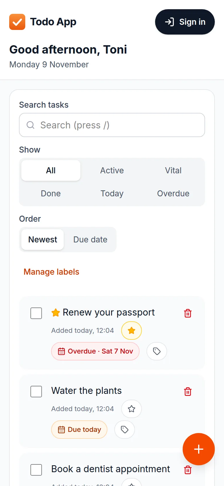
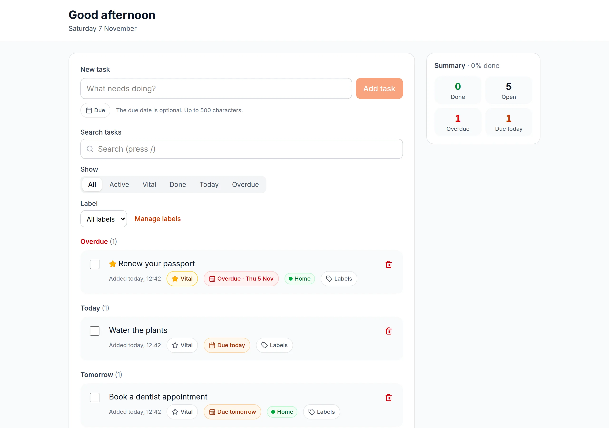
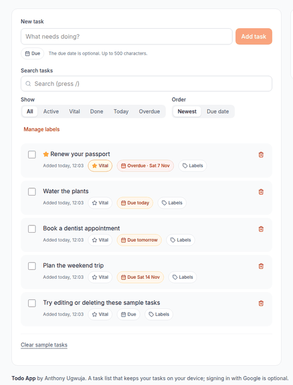

# Todo App

A task list that lives on your device, works offline, and syncs across your devices only if you sign in.

**[Open the live app →](https://todo.anthonyugwuja.dev)**

<p>
  
  
</p>

<picture>
  <source media="(prefers-reduced-motion: reduce)" srcset="docs/screenshots/demo-still.webp">
  
</picture>

## Features

- **Newest first or by due date:** a task you add appears at the top. Switch to Due date for Overdue, Today, Tomorrow, Upcoming, No date and Done groups, regrouped at midnight.
- **Add, edit in place, complete, and delete with Undo** (Ctrl+Z or ⌘Z works too).
- **Vital tasks and colour labels**, with search, filters and the order kept in the URL, so they survive a reload.
- **Works offline and installs like an app:** everything it needs is cached on the first visit, so it opens and works without a connection.
- **Optional Google sign-in** syncs tasks, labels and your greeting name across devices. Without it, nothing leaves the device.
- **Nothing you write is lost:** edits in two tabs don't silently overwrite each other, and a deleted task stays deleted on every device.
- **Keyboard and screen-reader friendly:** `n` adds, `/` searches, there's a skip link, changes are announced, and axe finds no violations.

## How it's built

1. **Local-first store:** IndexedDB through Dexie is the only thing the interface reads, so the app never waits on the network.
2. **Optional sync:** signed in, rows push and pull in batches to Supabase Postgres under row-level security. A database trigger settles conflicts: last write wins, and a delete is final.
3. **Static export:** `next build` emits plain files. There's no server of our own; the browser talks to Supabase directly.
4. **Service worker:** precaches every exported file, never touches Supabase or Google requests, and only swaps versions when you press Reload.
5. **Tests:** about 340 Vitest and Testing Library tests, axe checks, and database tests that prove one user can't read or write another's rows.

Next.js 16 · React 19 · TypeScript · Tailwind CSS 4 · Dexie · Supabase · Vitest

## Run it

You need Node 22.13 or later and pnpm.

```bash
pnpm install
pnpm dev        # http://localhost:3000
pnpm test       # unit and component tests
```

Without a `.env.local`, the app runs guest-only: everything works on the device and the Sign in button is hidden. To turn on accounts, copy the example file and fill it in from your Supabase project (Project Settings → API Keys) and your Google OAuth client. Every value is public by design; the secret key is never needed.

```bash
cp .env.example .env.local
```

The service worker registers only in production builds:

```bash
pnpm build      # writes out/ and out/sw.js
pnpm start      # serves out/ at http://localhost:3000
```

The database tests run against a local Supabase stack, which needs Docker:

```bash
pnpm test:db    # starts the local stack, resets it from supabase/migrations, runs the RLS and trigger tests
```

## If Supabase pauses the project

Supabase's free plan pauses a project after 7 days without database activity, and emails a warning first. The app keeps working while it's paused: guests aren't affected, and a signed-in user sees "Accounts unavailable" while their changes wait on the device and sync once it's back.

1. **The warning email arrives.** On GitHub, open Actions → *Keep Supabase awake* and check its last run. It calls `public.ping()` every 3 days. If it hasn't run, press **Run workflow**. GitHub disables scheduled workflows after 60 days without repository activity, so re-enable it if it's switched off. If it fails, check the `SUPABASE_URL` and `SUPABASE_PUBLISHABLE_KEY` repository variables.
2. **The project is already paused.** In the Supabase dashboard, open the project and choose **Resume project**. It comes back with its data and settings in a few minutes. Supabase keeps a paused free project restorable only for a limited time, so resume it soon: the dashboard shows the deadline.
3. **It paused even though the ping ran.** That means Supabase isn't counting a table-free query as activity. Add a one-row `public.heartbeat` table readable by `anon`, in a new migration, and point the workflow at a read of that row instead of `public.ping()`.
